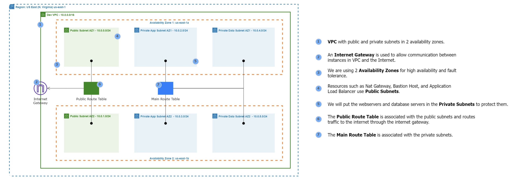
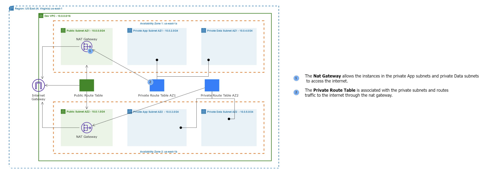
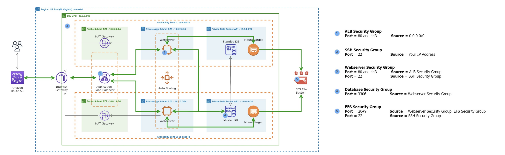

# Terraform Capstone Project: Automated WordPress Deployment on AWS
### Project Scenario
DigitalBoost, a digital marketing agency, aims to elevate its online presence by launching a high-performance WordPress website for their clients. As an AWS Solutions Architect, your task is to design and implement a scalable, secure, and cost-effective WordPress solution using various AWS services. Automation through Terraform will be key to achieving a streamlined and reproducible deployment process.

The project overview, necessary architecture, and scripts have been provided to help DigitalBoost with their WordPress-based website. Follow the instructions below to complete this Terraform Capstone Project.

### Project Deliverables
1. Documentation:
    - Detailed documentation for each component setup.
    - Explanation of security measures implemented.

2. Demonstration:
    - Live demonstration of the WordPress site.
    - Showcase auto-scaling by simulating increased traffic.

## Project Components

### 1. VPC Setup
#### VPC ARCHITECTURE



#### Objective: Create a Virtual Private Cloud (VPC) to isolate and secure the WordPress infrastructure.
#### Steps:

- Define IP address range for the VPC.
- Create VPC with public and private subnets.
- Configure route tables for each subnet.

```hcl
# Create VPC
resource "aws_vpc" "this" {
cidr_block = var.vpc_cidr
enable_dns_support = true
enable_dns_hostnames = true
tags = { Name = "wordpress-vpc" }
}


resource "aws_internet_gateway" "igw" {
vpc_id = aws_vpc.this.id
}

# Create Public subnet
resource "aws_subnet" "public" {
count = 2
vpc_id = aws_vpc.this.id
cidr_block = element(var.public_subnets, count.index)
availability_zone = element(var.azs, count.index)
map_public_ip_on_launch = true
}

# Create Private subnet
resource "aws_subnet" "private_app" {
count = 2
vpc_id = aws_vpc.this.id
cidr_block = element(var.private_app_subnets, count.index)
availability_zone = element(var.azs, count.index)
}

# Create DB subnet
resource "aws_subnet" "private_data" {
count = 2
vpc_id = aws_vpc.this.id
cidr_block = element(var.private_data_subnets, count.index)
availability_zone = element(var.azs, count.index)
}
```

### 2. Public and Private Subnet with NAT Gateway
#### NAT GATEWAY ARCHITECTURE



#### Objective: Implement a secure network architecture with public and private subnets. Use a NAT Gateway for private subnet internet access.
#### Steps:
- Set up a public subnet for resources accessible from the internet.
- Create a private subnet for resources with no direct internet access.
- Configure a NAT Gateway for private subnet internet access.

```hcl
resource "aws_eip" "nat" { domain = "vpc" }

resource "aws_nat_gateway" "this" {
allocation_id = aws_eip.nat.id
subnet_id = aws_subnet.public[0].id
}
```

### 3. AWS MySQL RDS Setup
#### SECURITY GROUP ARCHITECTURE



#### Objective: Deploy a managed MySQL database using Amazon RDS for WordPress data storage.
#### Steps:
- Create an Amazon RDS instance with the MySQL engine.
- Configure security groups for the RDS instance.
- Connect WordPress to the RDS database.

```hcl
resource "aws_security_group" "alb_sg" {
vpc_id = aws_vpc.this.id


ingress {
from_port = 80
to_port = 80
protocol = "tcp"
cidr_blocks = ["0.0.0.0/0"]
}
}


resource "aws_security_group" "app_sg" {
vpc_id = aws_vpc.this.id


ingress {
from_port = 80
to_port = 80
protocol = "tcp"
security_groups = [aws_security_group.alb_sg.id]
}
}


resource "aws_security_group" "rds_sg" {
vpc_id = aws_vpc.this.id


ingress {
from_port = 3306
to_port = 3306
protocol = "tcp"
security_groups = [aws_security_group.app_sg.id]
}
}
```

### 4. EFS Setup for WordPress Files
#### Objective: Utilize Amazon Elastic File System (EFS) to store WordPress files for scalable and shared access.
#### Steps:
- Create an EFS file system.
- Mount the EFS file system on WordPress instances.
- Configure WordPress to use the shared file system.

```hcl
resource "aws_efs_file_system" "this" {
encrypted = true
}


resource "aws_efs_mount_target" "mt" {
count = 2
file_system_id = aws_efs_file_system.this.id
subnet_id = aws_subnet.private_app[count.index].id
security_groups = [aws_security_group.app_sg.id]
}
```

### 5. Application Load Balancer
#### Objective: Set up an Application Load Balancer to distribute incoming traffic among multiple instances, ensuring high availability and fault tolerance.
#### Steps:
- Create an Application Load Balancer.
- Configure listener rules for routing traffic to instances.
- Integrate Load Balancer with Auto Scaling group.

```hcl
resource "aws_lb" "this" {
load_balancer_type = "application"
subnets = aws_subnet.public[*].id
security_groups = [aws_security_group.alb_sg.id]
}
```

### 6. Auto Scaling Group
#### Objective: Implement Auto Scaling to automatically adjust the number of instances based on traffic load
#### Steps:
- Create an Auto Scaling group.
- Define scaling policies based on metrics like CPU utilization.
- Configure launch configurations for instances.

```
resource "aws_launch_template" "this" {
image_id = var.ami_id
instance_type = "t3.micro"
user_data = base64encode(file("user-data.sh"))
security_group_names = [aws_security_group.app_sg.name]
}


resource "aws_autoscaling_group" "this" {
min_size = 2
max_size = 4
desired_capacity = 2
vpc_zone_identifier = aws_subnet.private_app[*].id
launch_template {
id = aws_launch_template.this.id
version = "$Latest"
}
}

resource "aws_autoscaling_policy" "cpu" {
autoscaling_group_name = aws_autoscaling_group.this.name
policy_type = "TargetTrackingScaling"


target_tracking_configuration {
predefined_metric_specification {
predefined_metric_type = "ASGAverageCPUUtilization"
}
target_value = 50
}
}
```

Note: Provide thorough documentation for each Terraform script and include necessary variable configurations. Encourage students to perform a live demonstration of the WordPress site, showcasing auto-scaling capabilities by simulating increased traffic. The documentation should explain the security measures implemented at each step.